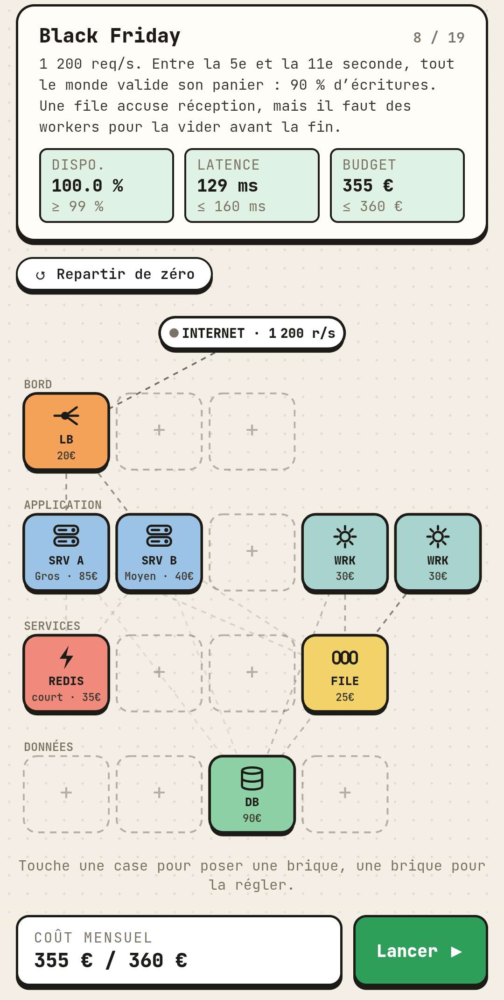

# Tenir la charge

Pose des serveurs, des caches, des files et des bases de données, puis regarde ton
infrastructure encaisser le trafic, les pannes et les attaques. Ou s'effondrer.

<p align="center">
  
</p>

## Comment on joue

1. Touche une case du plateau pour y poser une brique : load balancer, serveur, cache,
   file de messages, base, réplique…
2. Règle-la si besoin : taille du serveur, durée de vie du cache, mode du pare-feu.
3. Lance. Les requêtes traversent ton infra en direct, et les incidents prévus arrivent :
   un serveur qui tombe, un pic de trafic, un botnet, l'API de paiement qui rame…
4. Tiens les objectifs de **disponibilité**, de **latence** et de **budget**.

Chaque brique a son prix et ses limites. Le défi est de tenir sans sur-dimensionner.

## Trois modes

- **Missions** : 19 situations écrites à la main, du premier client à la migration à chaud,
  en passant par le Black Friday et la panne de région.
  Trois étoiles débloquent la suivante.
- **Croissance** : des tours générés, avec un trafic qui grossit à chaque tour. Ton infra
  doit rapporter plus qu'elle ne coûte, sinon c'est la faillite.
- **Défi du jour** : le même niveau pour tout le monde, renouvelé chaque jour. Le record,
  c'est l'infra la moins chère qui tient.

## Jouer en local

Il faut Node 22 ou plus. Il n'y a rien à installer.

```sh
npm run dev
```

Ouvre ensuite l'adresse affichée (par défaut http://localhost:3000). Ouvrir `index.html`
en double-cliquant ne marche pas : le navigateur bloque les modules du jeu en `file://`.

## Développer

```sh
npm test
```

Les choix d'architecture sont dans [`docs/decisions.md`](docs/decisions.md), les
conventions dans [`CLAUDE.md`](CLAUDE.md).
